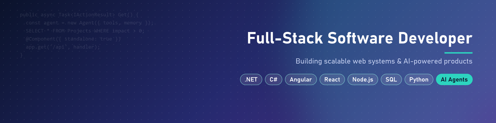

# Hi, I'm Leah 👋

### Full-Stack Software Developer · .NET · Angular · Python · AI Agents

I build **production web systems** and **AI agents that actually ship**.

---

## 🏛️ Experience

**Software Developer · Israel Ministry of Education** *(Dec 2025 – Aug 2026)*
- Full-stack development on a production system for managing the Ministry's organizational units: **Angular 19 + ASP.NET Core**, layered architecture, EF Core and SQL Server
- Secure login with a **BFF layer, ADFS / OIDC**, CSRF protection and role-based access
- **Redis** caching (Cache-Aside), a dynamic data table with server-side paging, the **upgrade to .NET 10**, and Jenkins deployments
- Built an internal **Python scaffolding tool** that creates a complete .NET + Angular project in one click. **The team uses it every day.**

---

## 🤖 Featured AI projects

| Project | What it does | Stack |
|---|---|---|
| 🔍 **[Job-Search Agent](https://github.com/leahlevovitz/jobsearch-agent-Leah)** | The same agent built twice: a hand-written harness on the raw Claude API (343 lines) vs. the Agent SDK (36 lines). 8/8 tests, 86–90% cache hit, cost measured per run | Claude API · Agent SDK · Python |
| 📚 **[Mini NotebookLM](https://github.com/leahlevovitz/Mini-NotebookLM---Studio-with-LangGraph)** | Research agent that searches the web, lets you approve sources (Human-in-the-Loop), then writes a sourced summary | LangGraph · Tavily · Streamlit |
| 🧠 **[RAG Dev Assistant](https://github.com/leahlevovitz/RAG-with-LlamaIndex)** | Smart router: open questions go to vector search, list questions go to exact structured lookup | LlamaIndex · Pinecone · Cohere |
| 🌐 **[MCP + Playwright Agent](https://github.com/leahlevovitz/Weather-MCP-with-Playwright)** | Gemini picks MCP tools that drive a real browser and answer from live web data | MCP · Gemini · Playwright |
| 🎫 **[AI Ticket Triage](https://github.com/leahlevovitz/AI-Ticket-Triage-System)** | A local LLM summarizes and routes tickets; deterministic rules decide urgency and escalation | Ollama · Flask |
| 💻 **[WinCmd Agent](https://github.com/leahlevovitz/WinCmd-Agent)** + **[Prompt Lab](https://github.com/leahlevovitz/AI_Engineering)** | Natural language → safe Windows commands, refined over 5 versioned prompts | Ollama · Groq · Gradio |

## 🏗️ Featured full-stack projects

| Project | What it does | Stack |
|---|---|---|
| 🎁 **[Auction Microservices](https://github.com/leahlevovitz/doker_project_AI)** | Event-driven back end with an API Gateway, BFF and a **RabbitMQ Saga** for distributed checkout | .NET · RabbitMQ · Redis · MongoDB · SQL Server · Docker |
| 🎁 **[Auction Web Client](https://github.com/leahlevovitz/project_Angular)** | Gift catalog, cart, auth and an admin area with a lottery | Angular 20 · PrimeNG |
| 🛍️ **[Online Store](https://github.com/leahlevovitz/react-node-project)** | MERN e-commerce with JWT auth and admin roles | React 19 · Redux · Node.js · MongoDB |
| ☁️ **[Serverless Catalog](https://github.com/leahlevovitz/aws-project)** | Angular SPA backed by AWS Lambda, deployed to S3 | Angular 21 · AWS |
| ✅ **[Task Manager](https://github.com/leahlevovitz/project_pyton-Task-management)** | Team task management with roles | Django |

---

## 🧰 Tech stack

**Languages**

**Frontend**

**Backend**

**Data**

**Cloud & DevOps**

**AI**

---

## 🎓 Education
- **Software Engineering**, MAHAT-certified · Seminar HaChadash, Jerusalem *(2024 – 2026)*
- **AI Development & Applications** · Malka Bruk *(2026)*

💬 *Good AI engineering isn't "use the model for everything". It's knowing when to use an LLM, when a simple rule is better, and when a human should decide.*

