  

 

**Software Developer** who loves turning complex problems into clean, reliable software, from full-stack web systems to AI-powered tools.

📍 **Jerusalem, Israel** · 🟢 Open to new opportunities

---

## 💼 Experience

<table>
<tr>
<td width="100%">

### 🏛️ Software Developer · Israel Ministry of Education
Dec 2025 – Aug 2026 · Jerusalem

- Full-stack development on a **production system** for managing the Ministry's organizational units
- Secure authentication with a **BFF layer and ADFS / OIDC**, role-based access, **Redis** caching, upgrade to **.NET 10**, Jenkins deployments
- ⭐ Built an internal **Python tool that creates a complete .NET + Angular project in one click**. The team uses it every day.

<kbd>Angular 19</kbd> <kbd>ASP.NET Core</kbd> <kbd>EF Core</kbd> <kbd>SQL Server</kbd> <kbd>Redis</kbd> <kbd>Python</kbd> <kbd>Jenkins</kbd>

</td>
</tr>
</table>

---

## 🤖 AI Projects

<table>
<tr>
<td width="50%" valign="top">

### [🔍 Job-Search Agent](https://github.com/leahlevovitz/jobsearch-agent-Leah)
The same agent built **twice**: a hand-written harness on the raw Claude API (343 lines) vs. the Agent SDK (36 lines). 8/8 tests, 86–90% cache hit.

<kbd>Claude API</kbd> <kbd>Agent SDK</kbd> <kbd>Python</kbd>

</td>
<td width="50%" valign="top">

### [📚 Mini NotebookLM](https://github.com/leahlevovitz/Mini-NotebookLM---Studio-with-LangGraph)
Research agent that searches the web, lets you **approve sources** (Human-in-the-Loop), then writes a sourced summary.

<kbd>LangGraph</kbd> <kbd>Tavily</kbd> <kbd>Streamlit</kbd>

</td>
</tr>
<tr>
<td width="50%" valign="top">

### [🧠 RAG Dev Assistant](https://github.com/leahlevovitz/RAG-with-LlamaIndex)
A smart router sends each question to **vector search** or **exact structured lookup**, so list questions never miss items.

<kbd>LlamaIndex</kbd> <kbd>Pinecone</kbd> <kbd>Cohere</kbd>

</td>
<td width="50%" valign="top">

### [🌐 MCP + Playwright Agent](https://github.com/leahlevovitz/Weather-MCP-with-Playwright)
Gemini picks **MCP tools** that drive a real browser and answer from live web data.

<kbd>MCP</kbd> <kbd>Gemini</kbd> <kbd>Playwright</kbd>

</td>
</tr>
<tr>
<td width="50%" valign="top">

### [🎫 AI Ticket Triage](https://github.com/leahlevovitz/AI-Ticket-Triage-System)
A local LLM summarizes and routes tickets; **deterministic rules** decide urgency and escalation.

<kbd>Ollama</kbd> <kbd>Flask</kbd> <kbd>Python</kbd>

</td>
<td width="50%" valign="top">

### [💻 WinCmd Agent](https://github.com/leahlevovitz/WinCmd-Agent) · [Prompt Lab](https://github.com/leahlevovitz/AI_Engineering)
Natural language → **safe** Windows commands, refined over 5 versioned prompts.

<kbd>Ollama</kbd> <kbd>Groq</kbd> <kbd>Gradio</kbd>

</td>
</tr>
</table>

## 🏗️ Full-Stack Projects

<table>
<tr>
<td width="50%" valign="top">

### [🎁 Auction Microservices](https://github.com/leahlevovitz/doker_project_AI)
Event-driven back end with an API Gateway, BFF and a **RabbitMQ Saga** for distributed checkout.

<kbd>.NET</kbd> <kbd>RabbitMQ</kbd> <kbd>Redis</kbd> <kbd>MongoDB</kbd> <kbd>Docker</kbd>

</td>
<td width="50%" valign="top">

### [🎨 Auction Web Client](https://github.com/leahlevovitz/project_Angular)
Gift catalog, cart, auth and an **admin area with a lottery**.

<kbd>Angular 20</kbd> <kbd>PrimeNG</kbd> <kbd>TypeScript</kbd>

</td>
</tr>
<tr>
<td width="50%" valign="top">

### [🛍️ Online Store](https://github.com/leahlevovitz/react-node-project)
MERN e-commerce with **JWT auth** and admin roles.

<kbd>React 19</kbd> <kbd>Redux</kbd> <kbd>Node.js</kbd> <kbd>MongoDB</kbd>

</td>
<td width="50%" valign="top">

### [☁️ Serverless Catalog](https://github.com/leahlevovitz/aws-project) · [✅ Task Manager](https://github.com/leahlevovitz/project_pyton-Task-management)
Angular SPA on **AWS Lambda + S3**, and a Django team task manager with roles.

<kbd>Angular</kbd> <kbd>AWS</kbd> <kbd>Django</kbd>

</td>
</tr>
</table>

---

## 🧰 Tech Stack

<table>
<tr><td><b>Languages</b></td><td><kbd>C#</kbd> <kbd>Java</kbd> <kbd>Python</kbd> <kbd>TypeScript</kbd> <kbd>JavaScript</kbd> <kbd>C</kbd> <kbd>SQL</kbd></td></tr>
<tr><td><b>Frontend</b></td><td><kbd>Angular</kbd> <kbd>React</kbd> <kbd>Redux</kbd> <kbd>PrimeNG</kbd> <kbd>HTML</kbd> <kbd>CSS</kbd></td></tr>
<tr><td><b>Backend</b></td><td><kbd>.NET / ASP.NET Core</kbd> <kbd>Node.js</kbd> <kbd>Express</kbd> <kbd>Spring Boot</kbd> <kbd>Django</kbd></td></tr>
<tr><td><b>Data</b></td><td><kbd>SQL Server</kbd> <kbd>MongoDB</kbd> <kbd>Redis</kbd> <kbd>Oracle</kbd></td></tr>
<tr><td><b>Cloud & DevOps</b></td><td><kbd>Docker</kbd> <kbd>AWS</kbd> <kbd>Azure</kbd> <kbd>Git</kbd> <kbd>Jenkins</kbd> <kbd>RabbitMQ</kbd></td></tr>
<tr><td><b>AI</b></td><td><kbd>LangChain</kbd> <kbd>LangGraph</kbd> <kbd>LlamaIndex</kbd> <kbd>MCP</kbd> <kbd>RAG</kbd> <kbd>Ollama</kbd> <kbd>Claude API</kbd></td></tr>
</table>

## 🎓 Education

- **Software Engineering Diploma** · MAHAT (מה"ט), Government Institute for Technology & Science Training · 2024 – 2026
- **AI Development & Applications** · Malka Bruk · 2026

 

💬 <i>Good AI engineering isn't "use the model for everything". It's knowing when to use an LLM, when a simple rule is better, and when a human should decide.</i>

